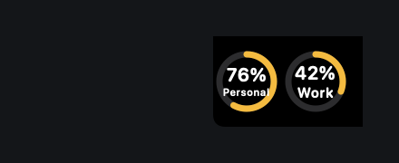
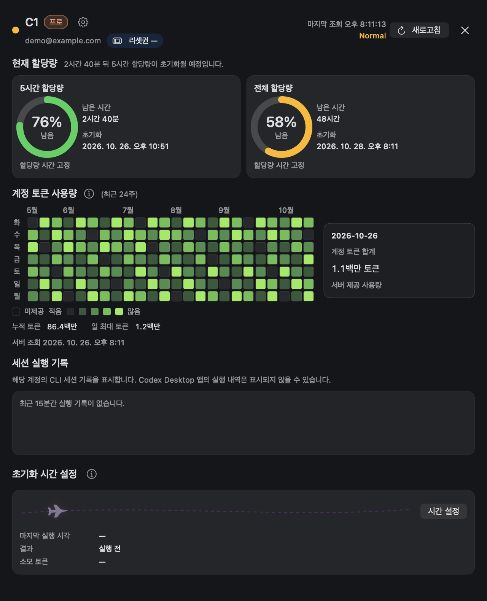
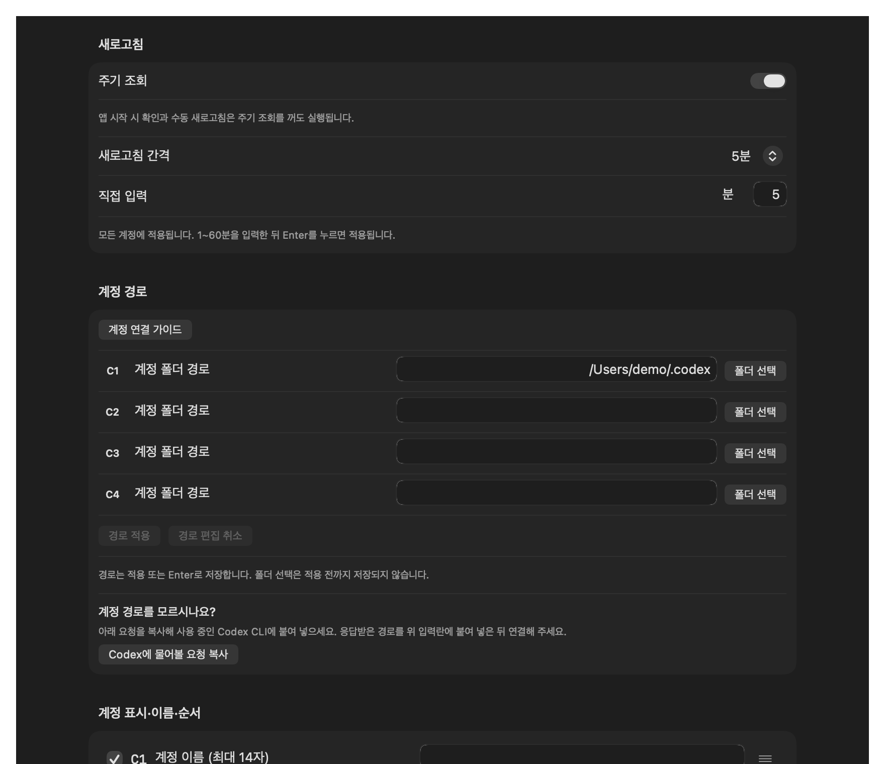

# Codex Quota Checker

[KOR](README.md) | **ENG**

- View quotas and usage for up to four Codex accounts in the macOS menu bar and notch
- An unofficial, independent app built with Codex

## Screenshots

- Captured from the current UI using sample account and usage data

### Menu bar and notch account display



### Account details

- Five-hour and overall quotas, 24-week token usage grid, session activity, and reset-time controls



### Settings



## Features

| Feature | Description |
|---|---|
| Quota monitoring | Remaining five-hour and overall quotas, reset times, and countdowns |
| Account management | Connect up to four accounts and configure names, visibility, and order |
| Token usage | Weekly bar or line charts, or a 24-week contribution grid, with server lifetime and peak daily totals |
| Today's usage | Use today's server value when available; otherwise use local records from the connected account |
| Usage information | Hover over `(i)` beside the token usage heading for calculation rules and query status |
| Session activity | Recent CLI sessions and subagent activity from the connected account |
| Reset times and notifications | Check whether quota times are fixed after a minimal request; advance, scheduled reset, and schedule-change notifications |
| Reset credits | View remaining credits and expiration dates, and approve credit use in a confirmation dialog |
| Service status and updates | View OpenAI service status; install updates and restart from the app |

- Token dates use UTC; earlier dates use server-provided history, with missing data distinct from zero
- Local data supplements only today's records available in the connected account folder
- Reset-time checks may consume usage; notifications depend on macOS permissions and system settings

## Requirements

- macOS 14 or later
- Codex CLI installed and signed in to the accounts you want to connect
- Release ZIPs target Apple Silicon (arm64); Intel Macs require a source build

## Installation

1. Download the app ZIP from the [latest release](https://github.com/jh-shi-n/codex_quota_checker/releases/latest).
2. Extract it, move `CodexQuotaChecker.app` to `/Applications`, and launch it.
3. If macOS blocks the first launch, verify the source and allow it under **System Settings → Privacy & Security → Open Anyway**.
4. In the app's connection guide, select the signed-in account's Codex folder and check the connection.

- Account folder: the CLI's `CODEX_HOME`, or `~/.codex` when unset
- Ad-hoc signed; Developer ID signing and notarization are not included. See [Apple's first-launch guide](https://support.apple.com/en-us/102445).
- Subsequent updates: **App Settings → App Update → Check for Updates → Install Update and Restart** (buttons currently shown in Korean)

### Build from source

- Requires a toolchain supporting Swift tools 6.0 and the macOS SDK
- The packaging script includes the executable, icon, and resources, and applies ad-hoc signing

```bash
git clone https://github.com/jh-shi-n/codex_quota_checker.git
cd codex_quota_checker
scripts/package_app.sh --output "$PWD/dist" --configuration release
open "$PWD/dist/CodexQuotaChecker.app"
```

## Usage

- Click an account donut to view quotas, token usage, and session activity
- Center number: remaining five-hour quota; outer ring: remaining overall quota
- Opening account details queries token usage; use the top-right refresh button for an immediate update
- Settings control account display, automatic refresh, chart style, date range, notifications, and launch at login
- Expanding the date range does not add history unavailable from the server

## License

- [MIT](LICENSE)
