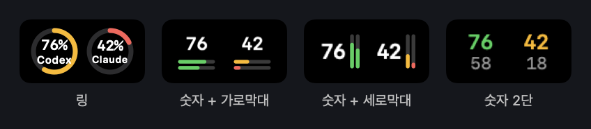
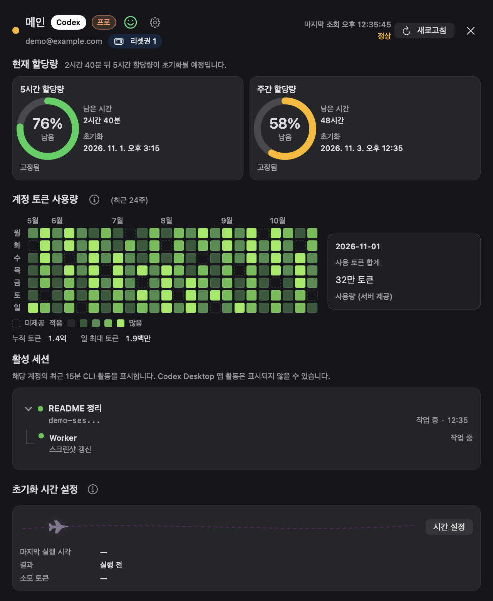
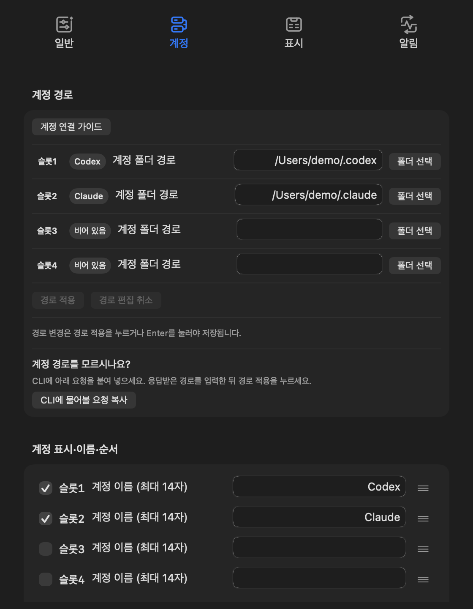

# Codex Quota Checker

> [26.10.31] In accordance with Codex and Claude policies on using multiple accounts, connecting multiple accounts for the same service on a single device is not recommended.

[KOR](README.md) | **ENG**

- Connect up to four accounts in total, using any mix of Codex and Claude (for example, two Codex + two Claude accounts)
- View connected accounts' quotas, session activity, and token usage in the macOS menu bar and notch
- An unofficial, independent app built with Codex/Claude

## Screenshots

- Captured from the current UI using sample account and usage data

### Menu bar and notch account display



### Account details

- Five-hour and overall quotas, 24-week token usage grid, session activity, and reset-time controls



### Settings



## Features

| Feature | Description |
|---|---|
| Quota monitoring | Remaining five-hour and overall quotas, reset times, and countdowns |
| Account management | Connect up to four accounts in total, mixing Codex and Claude or using either alone; configure names, visibility, and order |
| Token usage | Weekly bar or line charts, or a 24-week contribution grid; server lifetime and peak daily totals for Codex, local record totals and peak daily usage for Claude |
| Today's Codex usage | Prefer today's server value; use local records from the connected account when it is zero or unavailable |
| Token number units | Show integers below 10,000, then Korean units 만 (10,000), 백만 (1 million), 천만 (10 million), and 억 (100 million), with at most one decimal place; promote the unit at rounding boundaries |
| Usage information | Hover over `(i)` beside the token usage heading for calculation rules and query status |
| Session activity | Recent CLI sessions and subagent activity from the connected account |
| Reset times and notifications | Check whether quota times are fixed after a minimal request; advance, scheduled reset, and schedule-change notifications |
| Reset credits | View remaining credits and expiration dates, and approve credit use in a confirmation dialog |
| Notification permissions and tests | A section at the top of the Notifications tab shows the settings path, permission status, and test request submission time or failure reason |
| Service status and updates | View OpenAI service status; install updates and restart from the app; display installed and latest versions with build numbers |

- The four-account limit is shared across Codex and Claude, rather than four accounts per provider
- Token dates use UTC, with missing data distinct from zero
- Codex: earlier dates use server-provided history; local data supplements only today's records in the connected account folder
- Claude: aggregate up to 12 months from the connected folder's Stats cache and session records; exclude web usage, other devices, and account-wide server statistics. Switching accounts in the same folder may include the previous account's records
- Reset-time checks may consume usage; notifications depend on macOS permissions and system settings
- Notification permissions: **System Settings → Notifications → Application Notifications**; test records last for the current app session, and successful submission does not guarantee a visible notification banner

## Requirements

- macOS 14 or later
- Install and sign in to the CLI for each provider you connect: Codex CLI or Claude Code CLI (both are required for a mixed setup)
- Release ZIPs target Apple Silicon (arm64); Intel Macs require a source build

## Installation

1. Download the app ZIP from the [latest release](https://github.com/jh-shi-n/codex_quota_checker/releases/latest).
2. Extract it, move `CodexQuotaChecker.app` to `/Applications`, and launch it.
3. If macOS blocks the first launch, verify the source and allow it under **System Settings → Privacy & Security → Open Anyway**.
4. In the app's connection guide, select the signed-in Codex or Claude account folder and check the connection.

- Codex account folder: `CODEX_HOME`, or `~/.codex` when unset
- Claude account folder: `CLAUDE_CONFIG_DIR`, or `~/.claude` when unset
- Ad-hoc signed; Developer ID signing and notarization are not included. See [Apple's first-launch guide](https://support.apple.com/en-us/102445).
- Subsequent updates: **App Settings → App Update → Check for Updates → Install Update and Restart** (buttons currently shown in Korean)

### Build from source

- Requires a toolchain supporting Swift tools 6.0 and the macOS SDK
- The packaging script includes the executable, icon, and resources, and applies ad-hoc signing

```bash
git clone https://github.com/jh-shi-n/codex_quota_checker.git
cd codex_quota_checker
scripts/package_app.sh --output "$PWD/dist" --configuration release
open "$PWD/dist/CodexQuotaChecker.app"
```

## Usage

- Click an account donut to view quotas, token usage, and session activity
- Center number: remaining five-hour quota; outer ring: remaining overall quota
- Opening account details queries token usage; use the top-right refresh button for an immediate update
- Settings control account display, automatic refresh, chart style, date range, notifications, and launch at login
- Expanding the date range does not add history missing from the Codex server or the connected Claude folder

## License

- [MIT](LICENSE)
