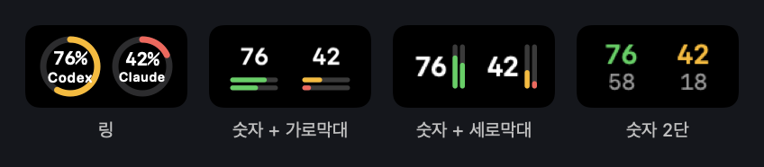
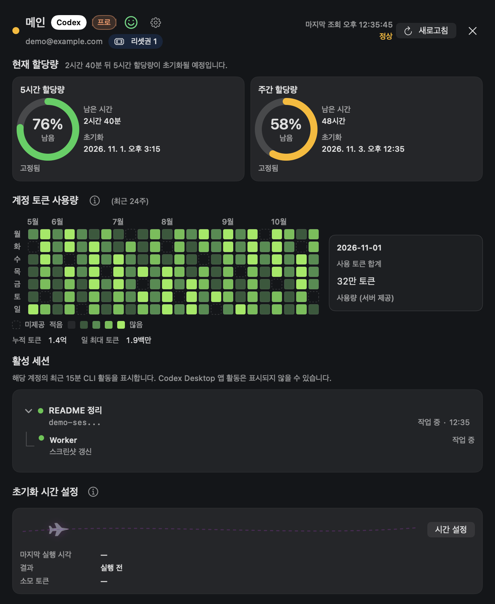
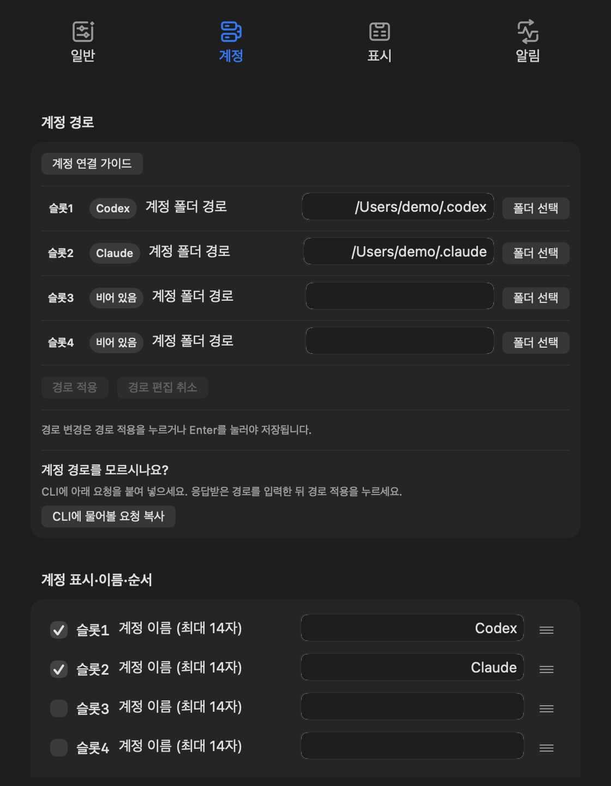

# LLM Quota Checker

> **[2026-10-31]** Codex의 "한 기기 내 유료계정 다중 사용 규정"에 따라, 해당 애플리케이션에 동일 서비스 여러 계정을 등록하는 것을 권장하지 않습니다.

**KOR** | [ENG](README.en.md)

- Codex·Claude 계정 합산 최대 4개 연결 지원 (제공자 구분 없이 조합 가능)
- macOS 메뉴 막대·노치에서 연결 계정의 할당량, 세션 실행 기록, 토큰 사용량 확인
- Codex/Claude로 제작한 비공식 독립 앱
- 정식 릴리스: [0.6.4](https://github.com/jh-shi-n/llm_quota_checker/releases/tag/0.6.4), 빌드 `34`

## 화면 미리보기

- 현재 구현된 UI에 예시 계정·사용량을 넣어 캡처한 화면

### 메뉴 막대·노치 계정 표시

- 링·숫자+가로막대·숫자+세로막대·숫자 2단 중 슬롯 스타일 선택



### 계정 상세

- 5시간·계정 주간 할당량, 최근 24주 토큰 사용량, 세션 실행 기록 및 초기화 시간 설정



### 설정



## 주요 기능

| 기능 | 설명 |
|---|---|
| 할당량 확인 | 5시간·계정 주간 할당량 잔여율, 초기화 시각과 남은 시간 표시 |
| 계정 관리 | 계정 연결, 이름·표시 여부·순서 설정 |
| 토큰 사용량 | 주간 막대·선그래프 또는 최근 24주 잔디, 누적·일 최대 토큰 표시 |
| 집계 안내 | 토큰 사용량 제목 옆 `(i)`에 마우스를 올려 집계 기준·조회 상태 확인 |
| 세션 실행 기록 | 연결 계정의 최근 CLI 세션과 하위 에이전트 활동 표시 |
| 초기화 시간·알림 | 할당량 시간 고정 여부 확인, 초기화 사전·도달 및 일정 변경 알림 |
| 리셋권 | 잔여 개수·소멸일 확인 및 확인 창 승인 후 사용 |
| 서비스 상태·업데이트 | OpenAI·Claude 서비스 상태 확인, 앱 내 업데이트 설치·재실행 |

### 토큰 집계 기준

- 날짜는 UTC 기준이며, 미제공 날짜는 0과 구분
- 기본 최근 12개월 표시, 설정의 날짜 표시 범위로 변경 가능
- Codex
  - 이전 날짜: 서버 제공 내역 사용
  - 당일: 서버 값 우선, 0이거나 미제공이면 연결 계정 폴더의 당일 로컬 기록으로 보완
- Claude
  - 연결 폴더의 Stats 캐시·세션 기록 기준 집계
  - 웹·다른 기기 및 계정 전체 서버 통계 제외
  - 같은 폴더에서 계정 변경 시 이전 계정 기록 포함 가능

### 참고

- 초기화 시간 확인 요청은 실제 사용량이 발생할 수 있음
- 알림 표시는 macOS 알림 권한·시스템 설정에 따름

## 요구 사항

- macOS 14 이상
- 연결할 제공자의 CLI 설치 및 계정 로그인: Codex CLI 또는 Claude Code CLI (혼합 연결 시 둘 다 필요)
- 제공 릴리스: Apple Silicon(arm64)용 앱 ZIP; Intel Mac은 소스 빌드 필요

## 설치

1. [최신 릴리스](https://github.com/jh-shi-n/llm_quota_checker/releases/latest)에서 앱 ZIP 다운로드
2. 압축 해제 후 `CodexQuotaChecker.app`을 `/Applications`로 이동하고 실행
3. 첫 실행이 차단되면 출처 확인 후 **시스템 설정 → 개인정보 보호 및 보안 → 확인 없이 열기**에서 허용
4. 앱의 연결 가이드에서 로그인한 Codex 또는 Claude 계정 폴더 선택 후 연결 확인

- Codex 계정 폴더: `CODEX_HOME` 경로, 별도 설정이 없으면 `~/.codex`
- Claude 계정 폴더: `CLAUDE_CONFIG_DIR` 경로, 별도 설정이 없으면 `~/.claude`
- 임시 서명(ad-hoc) 적용, Developer ID 서명·공증 미적용; 첫 실행 허용은 [Apple 안내](https://support.apple.com/ko-kr/102445) 참고
- 이후 업데이트: **앱 설정 → 앱 업데이트 → 업데이트 확인 → 업데이트 설치 후 재실행**

- 앱 표시 이름: **LLM Quota Checker**. 기존 앱 내 업데이트·설정·사용량 데이터 호환성을 위해 앱 파일명 `CodexQuotaChecker.app`과 내부 식별자 유지
- 배포 ZIP은 `LLMQuotaChecker-<버전>-macos-arm64.zip` 사용, 이전 앱을 위한 `CodexQuotaChecker-...zip` 호환 사본 함께 제공
- 저장소 이름 변경 전 앱(0.6.4 이하)은 업데이트 주소 검증으로 확인에 실패할 수 있음; 0.6.5부터 새 주소·이전 주소 지원

### 소스 빌드

- Swift tools 6.0 지원 도구 체인과 macOS SDK 필요
- 패키징 스크립트에서 실행 파일·아이콘·리소스 포함 및 임시 서명 적용

```bash
git clone https://github.com/jh-shi-n/llm_quota_checker.git
cd llm_quota_checker
scripts/package_app.sh --output "$PWD/dist" --configuration release
open "$PWD/dist/CodexQuotaChecker.app"
```

## 사용 방법

- **LLM 서비스 로컬 폴더 등록:** 연결 가이드·설정에서 Codex(`~/.codex`)·Claude(`~/.claude`) 계정 폴더 등록
- **사용 현황 확인:** 슬롯 클릭 시 연결된 서비스의 할당량·토큰 사용량·활동 세션 기록 표시
- **슬롯 표기 숫자:** 5시간 잔여 사용량 / 계정 주간 사용량
- **알림 지원:** 할당량 초기화 시 알림 제공

## 라이선스

- [MIT](LICENSE)
